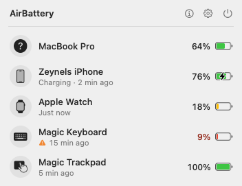
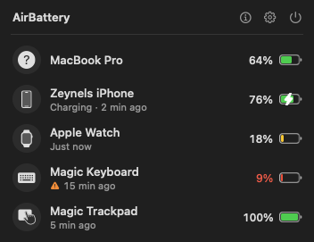
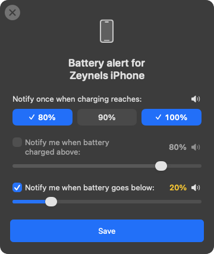

# 
<p align="center">

<h1 align="center">AirBattery</h1>
<h3 align="center">Den Akkustand aller Geräte auf dem Mac sehen – im Dock, in der Menüleiste und als Widget!<br><a href="./README.md">English</a> · <b>Deutsch</b> · <a href="./README_zh.md">中文 (Original)</a></h3>
</p>

> **Hinweis zum Fork:** Dies ist ein veränderter Fork von [lihaoyun6/AirBattery](https://github.com/lihaoyun6/AirBattery) und steht wie das Original unter der AGPL-3.0.
> Er verwendet eigene Bundle-IDs (`com.yenicizeynel.*`) und einen eigenen Update-Feed und bekommt daher keine Updates, die für das Original gedacht sind.

## Neu in diesem Fork

### Neu gestaltetes Menüleisten-Popover
<p align="center">
&nbsp;&nbsp;
</p>

- **Übersichtliche Kopfzeile** mit Buttons für Info, Einstellungen und Beenden, alle mit Tooltip
- **Statuszeile unter jedem Gerät**, immer sichtbar: *Wird geladen · vor 2 Min.*, *Voll in: 01:20*, *Am Stromnetz*, *Vollständig geladen* …
- **Veraltete Daten** (über 10 Minuten ohne Update) werden mit einem orangen Warnsymbol markiert
- **Aktionen beim Überfahren mit der Maus:** Akku-Alarm, in der Menüleiste anheften, Namen kopieren, ausblenden – jeweils mit Tooltip
- **Gerätename kopieren** zeigt kurz ein Häkchen statt eines Dialogs
- **Aus- und Einblenden** wirkt sofort; ausgeblendete Geräte stehen in einem eigenen Bereich und lassen sich mit einem Klick zurückholen
- **Nearcast-Geräte** haben einen eigenen Abschnitt
- Popover und Dock-Fenster **passen ihre Größe automatisch an** und aktualisieren sich live

### Benachrichtigungen bei 80 / 90 / 100 %
<p align="center">

</p>

- Du bekommst **einmalig** eine macOS-Mitteilung, wenn ein Gerät beim Laden 80, 90 oder 100 % erreicht. Jede Stufe lässt sich pro Gerät ein- und ausschalten.
- Springt der Akkustand über mehrere Stufen auf einmal, kommt nur die höchste. Fällt der Akku wieder unter eine Stufe, wird sie für den nächsten Ladevorgang erneut scharf geschaltet.
- Keine Fehlalarme beim Start der App und keine Wiederholungen, wenn der Wert um eine Stufe herum schwankt.
- Funktioniert für den eingebauten Mac-Akku und alle unterstützten Geräte und wird per Nearcast an deine anderen Macs weitergeleitet.
- Geprüft wird alle 30 Sekunden (der klassische Alarm „über X %“ prüft nur alle 5 Minuten).

### Außerdem
- **Deutsche Übersetzung** der App
- **Baut mit Xcode 26** (fehlender Import und eine zu komplexe Ausdrucksberechnung behoben)
- **Fehlerbehebung:** Ein zurückgestellter Akku-Alarm eines Geräts unterdrückt nicht mehr die Alarme aller anderen Geräte

## Screenshots (Original)
<p align="center">
<picture>
  <source media="(prefers-color-scheme: dark)" srcset="./img/preview_dark.png">
  <source media="(prefers-color-scheme: light)" srcset="./img/preview.png">
  
</picture>
</p>

## Installation und Verwendung
### Systemvoraussetzungen:
- macOS 11.0 oder neuer

### Installation:
Releases dieses Forks erscheinen [hier](../../releases/latest). Ein Homebrew-Tap ist geplant.

> `brew install lihaoyun6/tap/airbattery` installiert die **Original-App**, nicht diesen Fork.

Bis dahin kannst du die App mit Xcode 26 oder neuer selbst bauen:

```bash
git clone https://github.com/cepheiden/AirBattery.git
cd AirBattery
open AirBattery.xcodeproj
```

Wähle in Xcode unter *Signing & Capabilities* dein Team für die Targets `AirBattery`, `AirBatteryHelper` und `AirBatteryWidgetExtension` aus und starte dann das Scheme `AirBattery`.

### Verwendung:
- Nach dem Start erscheint AirBattery standardmäßig im Dock und in der Menüleiste, oder nur an einer der beiden Stellen (einstellbar).
- AirBattery findet automatisch alle Geräte, die die **„Nearbility Engine“** unterstützt, ganz ohne Einrichtung.
- Klicke auf das Dock- oder Menüleisten-Symbol oder füge ein Widget hinzu, um den Akkustand deiner Geräte zu sehen.
- **Lade-Benachrichtigungen:** Fahre im Popover mit der Maus über ein Gerät, klicke auf die Glocke und wähle die gewünschten Stufen (80 / 90 / 100 %).
- Mit **„Nearcast“** siehst du jederzeit auch den Akkustand anderer Macs und ihrer Zubehörgeräte im lokalen Netzwerk.
- In den Einstellungen kannst du das Menüleisten-Symbol auch durch eine Live-Akkuanzeige ersetzen, wie die des Systems.
- Bei Bedarf kannst du einzelne Geräte im Popover ausblenden und jederzeit wieder einblenden.

## Fragen und Antworten
**1. Warum wird mein iPhone / iPad / meine Apple Watch nicht angezeigt?**
> Stelle sicher, dass das iPhone / iPad diesem Mac vertraut ***(und mindestens einmal per Datenkabel mit dem Mac verbunden war, während AirBattery lief)***. Danach muss es sich nur im selben lokalen Netzwerk wie der Mac befinden.

**2. Muss meine Apple Watch vorher verbunden werden?**
> Nein. Sobald AirBattery ein gekoppeltes iPhone per WLAN oder USB erkennt, liest es automatisch auch den Akkustand der damit gekoppelten Apple Watch aus **(bei einem per Bluetooth gefundenen iPhone geht das nicht!)**

**3. Warum haben manche Geräte ein oranges ⚠️-Symbol?**
> Das Gerät hat seinen Akkustand seit über zehn Minuten nicht aktualisiert und ist vielleicht offline oder ausgeschaltet.

**4. Mein iPhone ist nicht im WLAN. Bekomme ich trotzdem den Akkustand?**
> Aktiviere in den Einstellungen **`iPhone / iPad(Cellular) over BT`** und lass Bluetooth am Gerät eingeschaltet ***(nur für iPhone oder iPad mit Mobilfunk!)***

**5. Warum braucht AirBattery Zugriff auf Bluetooth?**
> AirBattery wertet Bluetooth-Pakete der Zubehörgeräte aus, um deren Akkustand zu ermitteln.

**6. Ich bekomme keine Lade-Benachrichtigungen.**
> Prüfe, ob Mitteilungen für AirBattery unter *Systemeinstellungen → Mitteilungen* erlaubt sind und ob im Akku-Alarm des Geräts mindestens eine Stufe ausgewählt ist.

## Lizenz
[AGPL-3.0](./LICENSE), dieselbe Lizenz wie beim Originalprojekt. Originalwerk © lihaoyun6.

## Den ursprünglichen Entwickler unterstützen
AirBattery wurde von [lihaoyun6](https://github.com/lihaoyun6) entwickelt. Wenn dir die App gefällt, unterstütze gerne das Originalprojekt:


## Danksagung
[libimobiledevice](https://github.com/libimobiledevice/libimobiledevice) @libimobiledevice
> AirBattery nutzt ausführbare Dateien und Laufzeitbibliotheken, die aus libimobiledevice (Version `73b6fd1`) kompiliert wurden. Im Zweifel kannst du sie gerne selbst kompilieren und ersetzen.

[comptest](https://gist.github.com/nikias/ebc6e975dc908f3741af0f789c5b1088) @nikias
> AirBattery nutzt ausführbare Dateien, die aus diesem Quellcode kompiliert wurden. Im Zweifel kannst du sie gerne selbst kompilieren und ersetzen.

[MultipeerKit](https://github.com/insidegui/MultipeerKit) @insidegui
> AirBattery nutzt MultipeerKit für die Kommunikation zwischen mehreren Macs im lokalen Netzwerk.

[ChatGPT](https://chat.openai.com) @OpenAI
> Teile des Codes im Originalprojekt wurden mit ChatGPT erzeugt oder überarbeitet.
